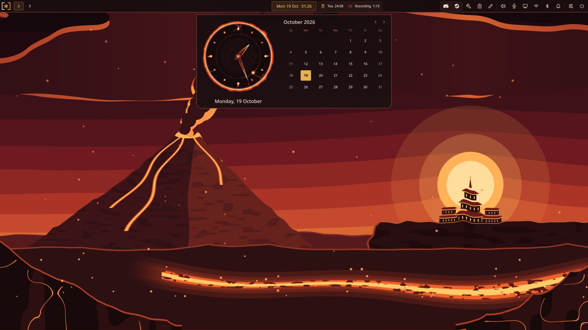
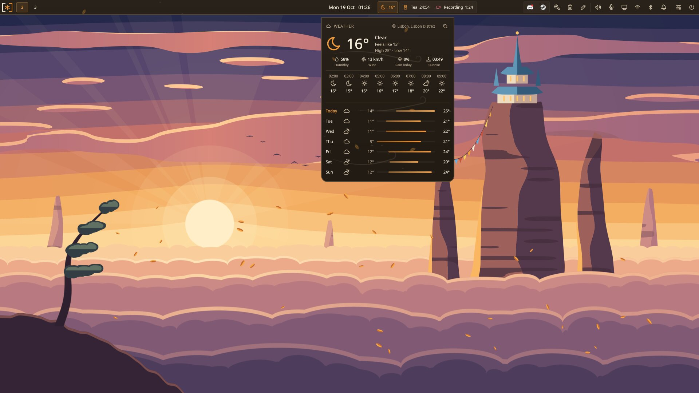
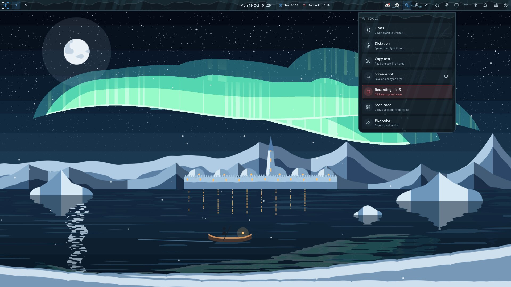
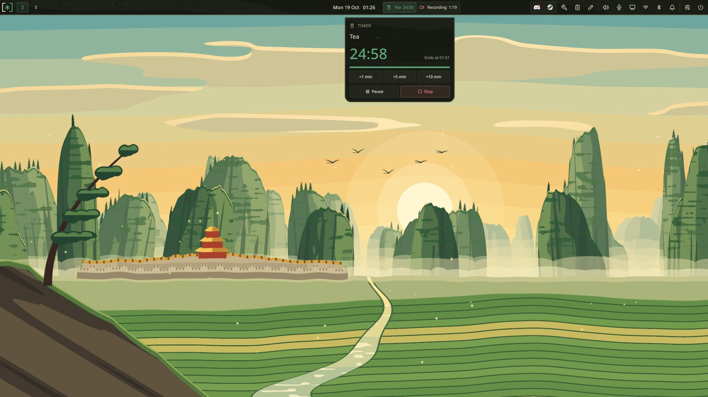
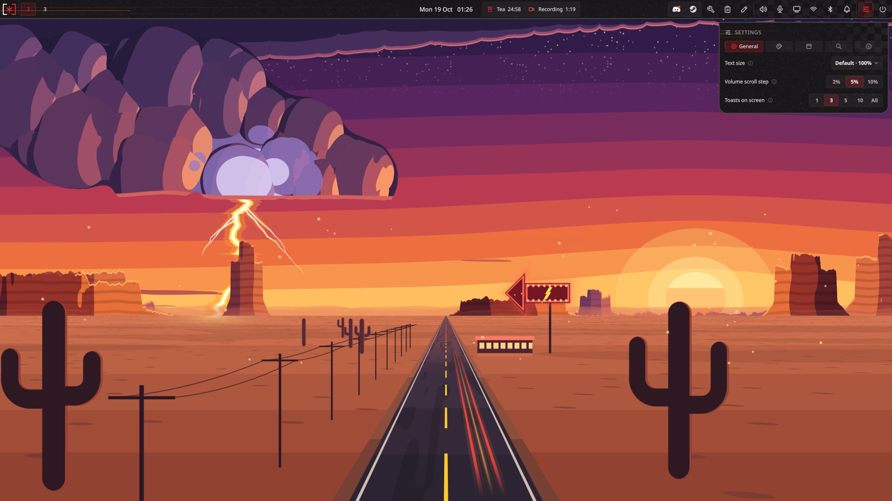
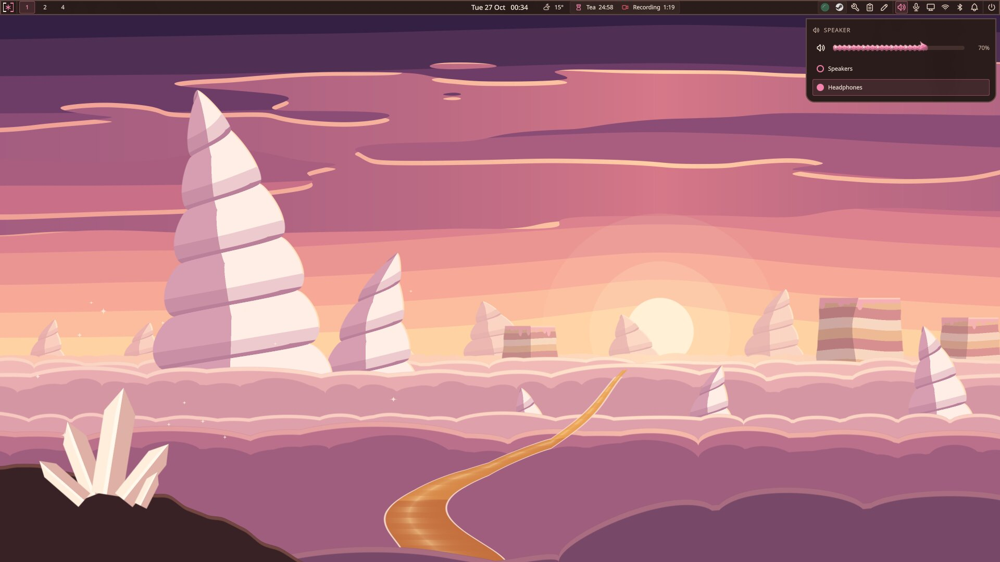

# Speshell's themes

Each theme brings its own palette, wallpaper, clock face, and effects. Rendered with `just shot <theme> <panel>`.

## Cosmos

The theme gallery previewing Cosmos: its wallpaper, palette, and orrery clock face, over the other themes.

## Fire

The clock panel: Fire's face, a charcoal dial in a ring of flames, beside the month.

## Air

The weather: the conditions now, the next hours, and the week.

## Water

The tools, with a screen recording running.

## Earth

A timer counting down in the bar, opened from its chip.

## Relâmpago

Settings.

## Sugar

The sound panel: frosting piped along each slider's track, ending at the knob in a kiss.

