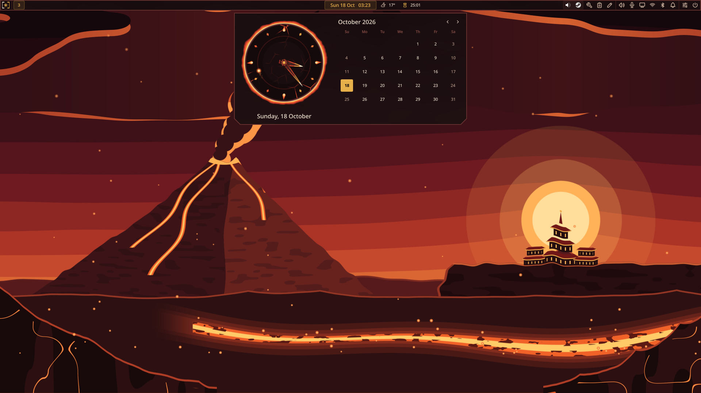
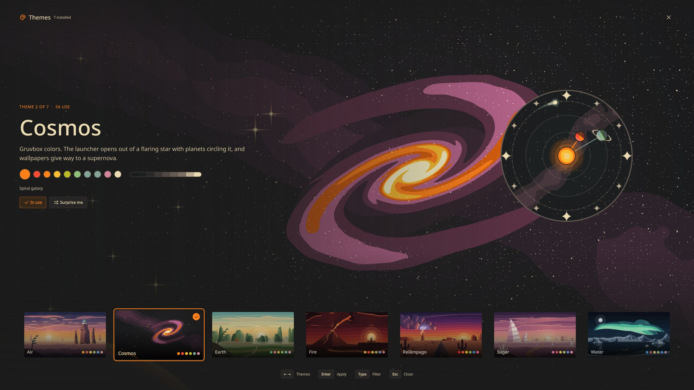

# Speshell

This is Speshell, pronounced *special*. My [Quickshell](https://quickshell.outfoxxed.me/) config. Why is it special, you may ask? Well, because it's mine. Borrow whatever is useful.

<p align="center">
  
  
</p>

<p align="center"><a href=".github/screenshots/README.md">See every theme</a></p>

## Features

- A bar on every screen: workspaces, the clock with the weather and your timers, the playing track, the tray, and a button for each panel
- Clock panel: a clock face in the theme's style beside the month, and a button that opens Google Calendar in the browser
- Weather panel: the conditions now, the next hours, and the week
- Panels for audio output and input, displays and brightness, network (Wi-Fi, and NetworkManager's VPN and WireGuard profiles), Bluetooth, battery, notifications with Do Not Disturb, media, power, Markdown notes, clipboard history, and tools
- On a laptop: the battery's charge in the bar, low-battery warnings, dimming, locking, and sleeping on idle, hibernating, a lower brightness on battery, locking before the lid sleeps it, the laptop's display off while docked with the lid closed, and an OSD for brightness, the keyboard backlight, the microphone, the touchpad, and airplane mode (see [Laptops](#laptops))
- Launcher: apps, open windows and apps hidden in the tray, a calculator, web searches and your own bangs
- Theme gallery: every theme over its wallpaper, previewed full screen in its own colors with its clock face, and its wallpapers to pick from
- Lock screen, login screen (greetd), and password prompts (polkit) in the theme: its wallpaper, its clock face, and its colors (see [Lock, login, and passwords](#lock-login-and-passwords))
- Tools: timers, dictation, copy text from the screen (OCR), screenshots, screen recording, QR codes, color picker
- What's running, as chips in the bar: screen recording, dictation, and anything that publishes over IPC
- Themes with wallpapers and animated effects, and other apps themed to match

Panels for missing hardware or tools hide themselves. Speshell runs on any Wayland compositor with layer-shell; on [Hyprland](https://hyprland.org/) it also shows workspaces in the bar and arranges displays.

## Requirements

Quickshell ≥ 0.3, PipeWire/WirePlumber, NetworkManager, BlueZ, libnotify, UPower, polkit.

Optional: Hyprland (workspaces, the Displays panel), `brightnessctl`, `openconnect` (OpenConnect VPN logins), `libsecret` (remembering VPN passwords in the keyring), `greetd` and `jq` (the login screen), `power-profiles-daemon` (power profiles), `matugen` (app themes), `cliphist`, `wl-clipboard`, `xdg-utils`, and the tools' programs below.

## Install

On Arch:

```bash
git clone https://github.com/vcoscrato/speshell.git
cd speshell/packaging
makepkg -si
```

Start it with your session, and bind the launcher to a key. On Hyprland:

```lua
hl.on("hyprland.start", function()
    hl.exec_cmd("speshell --no-duplicate --daemonize")
end)

hl.bind("SUPER + SPACE", hl.dsp.exec_cmd("speshell launcher toggle"))
hl.bind("SUPER + C", hl.dsp.exec_cmd("speshell panel toggle clock"))
```

Speshell dims, locks, and sleeps on idle by itself (see [Laptops](#laptops)), so leave hypridle or swayidle out, or set the `[Idle]` steps to 0.

The first run seeds `~/.config/speshell/config.ini`; upgrades never touch it or `~/.local/share/speshell`.

## The bar

The Speshell mark at the left opens the launcher, followed by the screen's workspaces. The clock sits in the middle and opens the clock panel; the playing track sits before it, its cover opening the player, and the weather, your timers, and what's running after, opening the forecast and each timer. A dictation or a screen recording shows there as a chip with its running time: click it to finish, and right-click a dictation to discard it. The tray and the panel buttons fill the right. Scroll over the speaker, microphone, or display button to change the volume or brightness, and right-click the speaker or microphone to switch devices.

`speshell panel open|toggle NAME` opens a panel from a keybinding; `speshell panel list` names them.

## Configuration

Options are in `~/.config/speshell/config.ini`, opened from the Power panel's header, and documented by [`config.example.ini`](config.example.ini). Edits apply on save; an invalid file keeps the previous settings and shows the error.

The weather, on with `[Weather] enabled`, comes from [Open-Meteo](https://open-meteo.com/) for `[Weather] location`, or, left empty, for where [ipinfo.io](https://ipinfo.io/) places your IP address. Click the place in the weather panel's header to change it. Units follow your locale's measurement system.

## Launcher

`speshell launcher [open|close|toggle]`

| Input | Result |
|---|---|
| text | Apps by name, initials, or fuzzy match, each app's open windows first, by app or title; a web search if nothing matches |
| `2 * (8 + 4)`, `= sqrt(144)` | Calculator; Enter copies the result |
| `!yt query` | A bang from `[Launcher.Bangs]` |
| `? query` | Search with `[Launcher] searchUrl` |
| `!theme`, or "themes" | Open the theme gallery |
| `!mirror` | Mirror the displays, or extend them again |

Unknown bangs go to the search engine, so its own bangs work too.

A window result focuses it, switching workspace or showing the scratchpad it's on. An app closed to the tray, such as Steam or Discord, shows as hidden in the tray, and its result brings the window back. Clicking a notification does the same for the app that sent it, after its own action: a toast, or a row in the Notifications panel, where the arrow expands a long one.

## Tools

The **Tools** panel sets up timers and runs each tool whose programs are installed; the others don't show. Areas are picked with a selection in the theme's colors, and results arrive as toasts. A tool run from the panel closes it first; run from a keybinding, it leaves an open panel on screen, so a screenshot can show it.

Its Timer row puts a new timer in the bar and opens it there: name it if you like, then pick a preset, or type a length like `25`, `1h30`, or `90s`, or an end time like `at 21:30`. Each timer stays in the bar until it ends, when a notification arrives even through Do Not Disturb. Click one to rename it, add 1, 5, or 10 minutes, pause, or stop it; scroll over it to change it by a minute, and right-click to pause or resume. `speshell timer` starts and controls timers too, acting on the one that ends first when given no name.

| Tool | Does | Needs |
|---|---|---|
| Dictation | Records until run again, then types and copies what you said | `pipewire`, `whisper.cpp`, `wtype`, `wl-clipboard`, `curl` (model download) |
| Copy text | Copies the text in an area | `grim`, `slurp`, `tesseract` and a `tesseract-data-*` per language, `wl-clipboard` |
| Screenshot | Saves an area or the screen to Pictures/Screenshots and copies it; Annotate opens it in Swappy | `grim`, `slurp`, `wl-clipboard`, optionally `swappy` |
| Record | Records an area or the screen, with sound, to Videos/Recordings until run again | `wf-recorder`, `slurp` |
| Scan code | Copies a QR code or barcode, offering to open links | `grim`, `slurp`, `zbar`, `wl-clipboard` |
| Pick color | Copies a pixel's hex color | `hyprpicker`, `wl-clipboard` |

`[Tools]` in the config sets the OCR and dictation languages, dictation vocabulary, and Whisper model. Bind them with `speshell tool`:

```lua
hl.bind("SUPER + D", hl.dsp.exec_cmd("speshell tool dictate"))
hl.bind("SUPER + SHIFT + D", hl.dsp.exec_cmd("speshell tool dictate cancel"))
hl.bind("Print", hl.dsp.exec_cmd("speshell tool screenshot"))
hl.bind("SHIFT + Print", hl.dsp.exec_cmd("speshell tool ocr"))
hl.bind("SUPER + R", hl.dsp.exec_cmd("speshell tool record"))
hl.bind("SUPER + SHIFT + R", hl.dsp.exec_cmd("speshell tool record screen"))
```

## Power

`[Power] mode` sets how much power the system and Speshell use: `maximum`, `balanced` (the default), or `saver` (see [Themes](#themes) for what each does to the effects). With `power-profiles-daemon`, the system's power profile follows: performance (balanced where there is none), balanced, or power-saver. `saverOnBattery` (on by default) switches to `saver` when the laptop is unplugged and back once it is plugged in; a mode picked in the Battery panel while unplugged lasts until then. A laptop sets both in the Battery panel; a desktop picks the mode in the Power panel.

## Lock, login, and passwords

**The lock screen** covers every screen with the theme's wallpaper, its clock face, and the date, over a password field that PAM checks as a login would (`/etc/pam.d/login`, so faillock's waits apply). Lock from the Power panel, with `speshell lock`, or `loginctl lock-session`; idling, sleep, and hibernate lock first, and sleep waits until the lock is on every screen, so waking shows it at once. The keyboard layout shows under the field when you switch between several. Bind it in place of a locker:

```lua
hl.bind("SUPER + L", hl.dsp.exec_cmd("speshell lock"))
hl.config({ misc = { allow_session_lock_restore = true } })
```

The lock outlives a crash: Hyprland keeps the session locked, and a Speshell started again locks again at once, which `allow_session_lock_restore` lets it do. From a console (Ctrl+Alt+F3), `hyprctl --instance 0 dispatch 'hl.dsp.exec_cmd("speshell")'` starts it.

**Password prompts**: Speshell is the session's polkit agent, so `pkexec` and apps asking for an administrator's password ask over the focused screen. Don't also start another agent, such as `polkit-kde-agent` or `hyprpolkitagent`.

**The login screen** runs under [greetd](https://sr.ht/~kennylevinsen/greetd/) as a bare Hyprland showing the theme you last had: the users' accounts, the Wayland sessions, and sleep, restart, and power off, remembering whom and what you picked. In `/etc/greetd/config.toml`:

```toml
[default_session]
command = "speshell-greeter"
user = "greeter"
```

Then `systemctl enable greetd` in place of your display manager, and `systemctl enable --now speshell-greeter-theme@$USER.path`, which copies your theme's colors and wallpaper to `/var/lib/speshell/theme` whenever it changes (the login screen can't read your home). The keyboard follows `localectl set-x11-keymap`; `/etc/speshell/greeter.lua`, if present, adds Hyprland settings for the login screen, such as monitors. To unlock KDE Wallet or GNOME Keyring at login, add their PAM lines to `/etc/pam.d/greetd`; KDE Wallet also needs `/usr/lib/pam_kwallet_init` run at the start of the Hyprland session, before anything asks for a secret. If the monitor stays black for a moment after login, the console between the two Hyprlands runs another mode: set it to Hyprland's with the kernel's `video=` parameter, such as `video=1920x1080@300`.

## Laptops

Speshell treats a laptop as one: what follows shows with a battery, a backlight, or a lid, and stays out of the way on a desktop.

**The bar** shows the battery's charge beside its icon, unless the laptop rests plugged in, full or held at a charge limit. Below `[Battery] lowLevel` (20%) the icon turns yellow and a notification says how long is left; below `criticalLevel` (10%) it turns red and a notification stays on screen, through Do Not Disturb, until you plug in. UPower's own critical action, hibernating or powering off at 2%, still runs after.

Short of room on the screen, the bar goes compact before it grows past the edge: the clock drops the date, the weather its temperature, and the timers and chips their names. Hovering each still says it all.

**The Battery panel** shows the charge, the time to full or empty, the power draw, and the battery's health (its capacity against its design), and the charge of devices like a mouse or headphones.

**Idle**, by `[Idle]`, on battery only: after 2 minutes the screen dims and the keyboard backlight goes off, at 5 the session locks, at 6 the displays turn off (Hyprland), and at 15 the laptop sleeps. Input undoes each step. Apps can hold idling off, as video players do; playing media holds off sleep; and **Keep awake**, the cup in the bar on battery, or `speshell awake on`, holds it all off until turned off. Whatever puts the system to sleep, closing the lid included, locks first.

**Hibernate** shows in the Power panel when logind can hibernate (a swap that fits memory, and resume set up), and locks first as Sleep does.

**On battery**, by `[Backlight] batteryPercent` or beside the brightness in the Displays panel: unplugging lowers the screen to that at most, and plugging in brings it back, unless you turned it up since.

**Night light**, by `[NightLight]`: with `hyprsunset` installed (Hyprland), the Displays panel's header and `speshell nightlight toggle` warm every display to `temperature` (4000 K). Speshell runs hyprsunset itself, so don't also start one from Hyprland's config.

**The lid**: with another display on, closing the lid turns the laptop's display off (Hyprland), and opening it, or unplugging the last other display, brings it back as it was.

**Keys**: the OSD shows changes made outside Speshell's panels: volume, brightness, the keyboard backlight, the microphone's mute, the touchpad, and airplane mode. Brightness keys that run `brightnessctl` already show it. Airplane mode is also in the Network panel's header, the keyboard backlight beside the laptop display's brightness in the Displays panel.

```lua
hl.bind("XF86MonBrightnessUp", hl.dsp.exec_cmd("speshell brightness up"), { locked = true, repeating = true })
hl.bind("XF86MonBrightnessDown", hl.dsp.exec_cmd("speshell brightness down"), { locked = true, repeating = true })
hl.bind("XF86KbdBrightnessUp", hl.dsp.exec_cmd("speshell brightness keyboard"), { locked = true })
hl.bind("XF86TouchpadToggle", hl.dsp.exec_cmd("speshell touchpad toggle"), { locked = true })
hl.bind("XF86RFKill", hl.dsp.exec_cmd("speshell airplane toggle"), { locked = true })
hl.bind("XF86AudioMicMute", hl.dsp.exec_cmd("wpctl set-mute @DEFAULT_AUDIO_SOURCE@ toggle"), { locked = true })
```

On battery, Balanced also runs the theme's effects at 30 fps and looks for recordings started outside Speshell once a minute.

## Themes

Speshell ships Cosmos (the default), four elements (Fire, Air, Water, and Earth), Relâmpago, a racing theme, and Sugar, a confectionery theme. Each has a palette, a wallpaper, launcher and wallpaper effects, a still painted backdrop behind the bar and its panels, themed slider and switch knobs with small effects as you use them, and a clock face (see [shell/themes](shell/themes/README.md)). Pick one in the theme gallery: open Themes from the launcher (`!theme`), or run `speshell theme open`.

The gallery fills the screen with the theme it previews: its wallpaper, its colors on the whole shell, its palette, and its clock face, ticking. The themes line up along the bottom, each over its wallpaper in its own colors. ←/→ (or the scroll wheel) moves between themes, ↑/↓ between a theme's wallpapers when Speshell draws them and the theme has more than one, Enter applies, typing filters, and Esc closes without changing anything. Surprise me previews a theme at random.

Each theme comes in behind with its own wallpaper transition, as it would on the desktop, and so does each wallpaper. A quick run of moves, or a held key, waits for you to stop before playing one, and a move during a transition carries off whatever is on screen, so nothing jumps. Applying keeps what you are already looking at: the gallery's interface fades, any transition still playing finishes, and the desktop takes the theme underneath without playing it again, so only the bar comes back. Other screens play the transition as usual.

Set `drawWallpaper = true` under `[Appearance]` to let Speshell draw the desktop background. It is off by default so another wallpaper tool can stay in charge. `launcherTransitionSpeed`, `wallpaperTransitionSpeed`, and `controlEffectsSpeed` (0–3, default 1) speed up or slow down each kind of effect, and 0 turns it off. `[Power] mode` sets their frame rate: `maximum` animates at the display's refresh rate, `balanced` (the default) at 60 fps, and `saver` turns the effects off along with the interface's own motion. `shuffleAtLaunch` picks at random each time Speshell starts: `wallpaper` (another wallpaper of the theme), `theme` (another theme), or `both`; the default is `off`.

Each theme remembers the wallpaper last set for it, so switching back to a theme brings that wallpaper back; a theme you have not picked a wallpaper for starts with its first.

A theme is a folder with an optional `theme.ini` and any images. Add your own under `~/.config/speshell/themes`; a folder named after a shipped theme adds wallpapers to it, and its `theme.ini` replaces the shipped one.

```ini
# ~/.config/speshell/themes/sunset/theme.ini
[Theme]
name = Sunset
description = Dusk over the sea, shown in the theme gallery.
effects = fire

[Colors]
base = #1d1315
text = #f3e3d3
accent = #f0702f
```

Colors use the keys of [`shell/themes/cosmos/theme.ini`](shell/themes/cosmos/theme.ini); missing ones come from Cosmos. Custom effects go in `~/.local/share/speshell/effects` (see [shell/effects](shell/effects/README.md)).

### App themes

Other apps can follow the theme. Speshell writes the active palette to `~/.local/share/speshell/palette.json` in [matugen](https://github.com/InioX/matugen)'s JSON format and, when it changes, sets GTK's `color-scheme` to the theme's light or dark and runs `matugen json` on it if `~/.config/matugen/config.toml` exists. matugen renders the templates listed there and runs their hooks, so which apps follow, and how they reload, is up to that config. If matugen fails, a notification shows its error.

Templates see each color under Speshell's names (`{{colors.accent.default.hex}}`, `colors.base`, `colors.surface0`, …), under the Material names matugen templates use (`colors.primary`, `colors.surface_container`, `colors.on_surface`, …), and as base16 (`{{base16.base0d.default.hex}}`), so templates written for matugen work as they are. Each hue also comes as tints over `base` for apps without transparency: `colors.green_15`, `green_30`, and `green_50` are green at that percent. `{{mode}}` is `dark` or `light`, from the theme's `base` color.

The file is rewritten only when the palette changes, so restarting Speshell leaves the apps alone. After editing the matugen config, run `matugen json ~/.local/share/speshell/palette.json` to render it.

## CLI

```bash
speshell launcher [open|close|toggle]
speshell lock
speshell panel list | open NAME | toggle NAME | close
speshell theme list | get | set ID | shuffle [ID] | rescan | open | close | toggle
speshell wallpaper get | set PATH
speshell tool list | dictate [cancel] | ocr | screenshot [region|screen] | record [region|screen] | qr | color
speshell timer get | start LENGTH [NAME] | add LENGTH [NAME] | pause|resume|toggle|stop [NAME]
speshell activity set ID STATE LABEL [DETAIL] [ICON] [TONE]
speshell activity list | clear ID | refresh
speshell brightness get | up | down | set PERCENT | keyboard
speshell awake|touchpad|airplane|nightlight get | on | off | toggle
```

## Development

```bash
just lint test
just shaders   # compile effect shaders; needed once in a checkout
just shot fire # the bar in a theme with each panel open, offscreen, and a contact sheet
```

`just lint` needs `shellcheck` besides Qt's tools. `shell/speshell` runs the checkout it sits in. Making themes is in [shell/themes](shell/themes/README.md), the effects API in [shell/effects](shell/effects/README.md), and the offscreen previews in [preview/](preview/README.md); agent notes are in [AGENTS.md](AGENTS.md).

Icons are a subset of [Tabler Icons](https://github.com/tabler/tabler-icons) (MIT), in `shell/icons/tabler/`, and a few of Speshell's own in their style, in `shell/icons/speshell/`.
